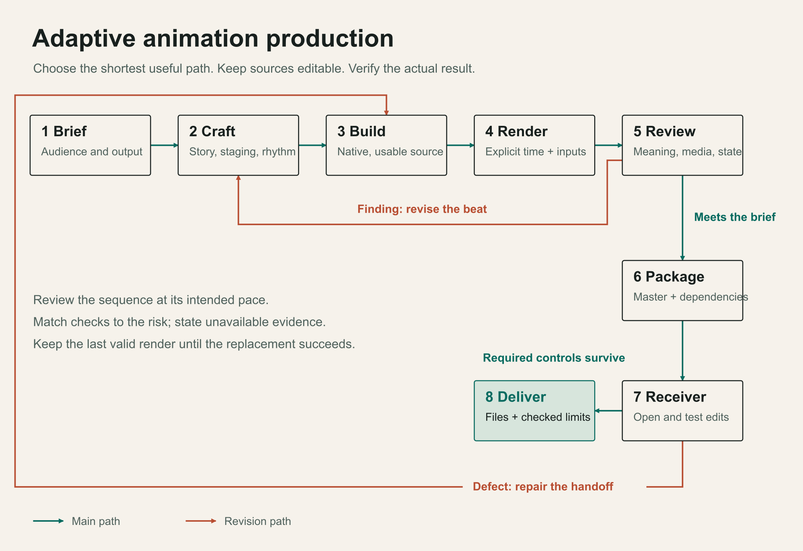
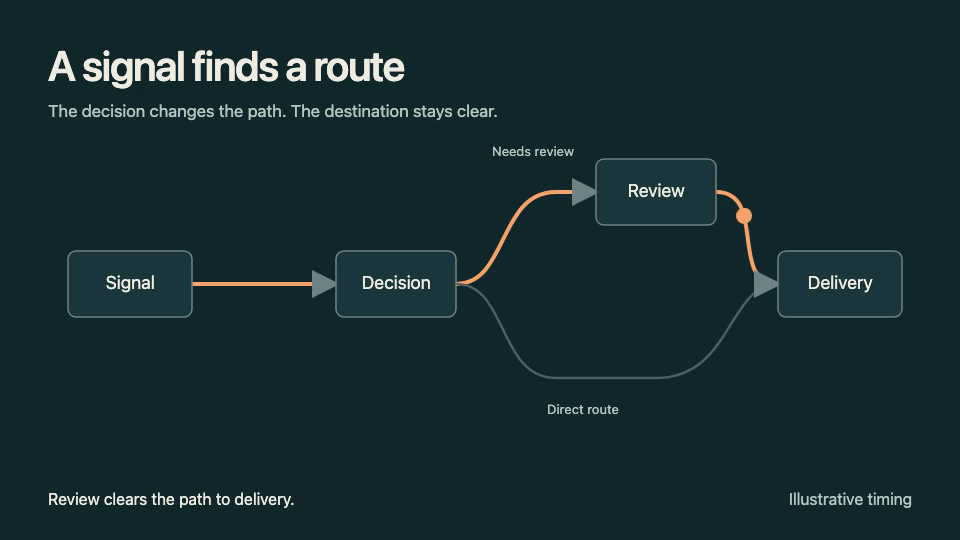

# Adaptive Animation Skill

An adaptable Codex skill for creating and improving animation, films, motion graphics, explainers and editable video projects. It connects the audience's purpose to visible action, chooses suitable native tools, and checks the delivered result.



The skill supports restrained scientific explanations, character work, cinematic 3D and expressive motion. It does not impose a visual style, model hierarchy, mandatory team or research phase on every request.

## Use it

Copy `animation/` into your user-owned skills directory after preserving any existing version. Then ask, for example:

> Use $animation to turn this process into a clear eight-second explanation. Make the decision and consequence visible, keep the diagram editable, and deliver the native source and reviewed output.

For a quick edit, just provide the source and desired change. The skill should execute directly when additional planning would not help.

See [the skill](animation/SKILL.md) and [portable setup](animation/references/portable-setup.md). Core Python helpers use the standard library. FFmpeg/FFprobe provide media checks. Browser diagnostics optionally use installed Playwright, Sharp and Chrome. Native rendering, editing and voice engines are separate installations, and retained adapters have explicit compatibility requirements. No paid API is required.

## What this revision adds

- Concrete direction for causal action, motion hierarchy, pacing, semantic transitions and loops.
- One shared configuration system with PATH and explicit private-config support.
- H.264 verification independent of a Manim installation.
- Output-relative typography and more usable preview controls.
- A sampled browser pixel check for early, late, backward and repeated scene times.
- A dependency-free editable signal-routing example, plus an editable workflow and eight-slide presentation.

The current evidence and remaining limits are recorded in [validation](docs/validation.md). No small example establishes universal artistic quality or complete renderer coverage.

## Explore the example

[](animation/docs/causal-flow.mp4)

[Watch the eight-second example](animation/docs/causal-flow.mp4). It was captured as 240 explicit frames and verified after encoding.

Open [examples/causal-flow/index.html](examples/causal-flow/index.html) locally. Add `?preview=1` to the file URL for controls. The review/direct switch changes the explanation's route. Playback respects reduced-motion preferences; deterministic capture uses an explicit `renderFrame(seconds)` function. Timing is illustrative.

## Diagram and presentation

- [Editable SVG](animation/docs/diagram.svg), [PNG](animation/docs/diagram.png), [vector PDF](animation/docs/diagram.pdf)
- [Editable presentation](animation/docs/presentation.pptx)
- [Research and source notes](docs/research.md)

## Verify helper behavior

```sh
python3 -m unittest discover -s animation/tests -v
python3 animation/scripts/studio.py init /absolute/new-project \
  --brief 'An action and its visible consequence' --size 1280x720 --fps 30 --template motion
python3 animation/scripts/studio.py verify /absolute/movie.mp4 \
  --resolution 1280x720 --fps 30 --duration 6 --frames 180
```

The media tests require FFmpeg/FFprobe and use temporary fixtures. Optional engine paths are never silently installed. See each command's `--help` and the [production reference](animation/references/production.md) for its scope.

## License and credits

Original instructions, helper code, example and release materials use the [MIT license](LICENSE). Bundled **GSAP has its own Standard License**, which includes restrictions and is not MIT. Inter and Newsreader use the SIL Open Font License. Retain the [third-party notices](animation/assets/THIRD-PARTY.txt). This repository does not redistribute creator videos or claim that a prompt-gallery license clears them.

Research began with [Awesome Opus 5.5 Videos](https://github.com/yihui-dev/awesome-opus5-5-videos) and expanded to original prompts, source implementations and primary technical documentation. The workflow is model-adaptive and makes no model superiority claim.
