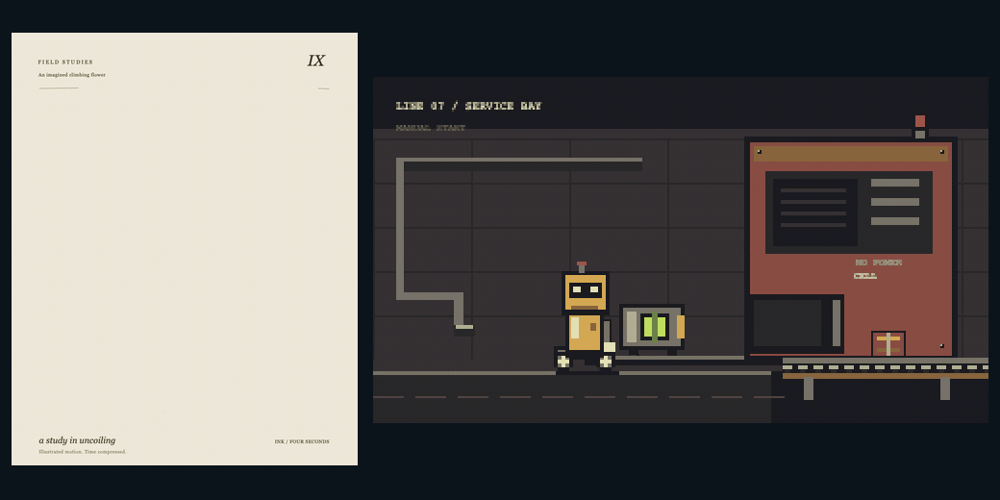

# Adaptive Animation

Animation and motion design for Codex, for creators and developers who need a finished result and the source to revise it. Make films, explainers, interactive motion, or a single style frame without inheriting a house palette, composition, or renderer.

[](examples/ink-study/README.md)

*Original four-second studies with different staging and motion. [Ink source and movie](examples/ink-study/README.md) · [Pixel source and movie](examples/power-cell/README.md)*

## Install

Requires Codex and Python 3.9+. The skill instructions work with your available tools; optional helpers have separate dependencies.

```sh
git clone https://github.com/nazeeh111/adaptive-animation-skill.git
cd adaptive-animation-skill
python3 - <<'PY'
import os, shutil
from pathlib import Path
skill_home = Path(os.environ.get('CODEX_HOME', str(Path.home() / '.codex')))
destination = skill_home / 'skills' / 'animation'
destination.parent.mkdir(parents=True, exist_ok=True)
shutil.copytree('animation', destination)
print(destination)
PY
```

The copy refuses an existing installation. Preserve it and merge intentionally, keeping private `scripts/local.json`. [Setup, dependencies and update boundaries](animation/references/portable-setup.md).

## Try a working example

From the checkout, open the dependency-free interactive explanation:

```sh
python3 -c "from pathlib import Path; import webbrowser; webbrowser.open(Path('examples/causal-flow/index.html').resolve().as_uri() + '?preview=1')"
```

Play, scrub, switch routes, or resize the browser. The preview reflows on narrow screens and responds to reduced-motion preferences. Its fixed-film capture remains separate.

Then ask Codex:

> Use $animation to explain how this mechanism works in eight seconds. Choose the visual direction for the subject, make the cause and consequence visible, and deliver editable source plus the checked result.

Supply a reference, existing project or exact change when you have one. A design-only request can finish as an editable composition or style frame.

## What it adds

- **Direction before decoration:** staging, performance, pacing, typography and sound chosen for the subject.
- **Native choices:** retain the drawings, rig, timeline, scene or browser source the work actually needs.
- **Useful execution:** neutral scaffolding, optional continuous spring retargeting, source recovery and focused media/browser checks.
- **Honest review:** distinguish correct state, encoded output, received story and unavailable perceptual judgment.

No framework migration, fixed style menu, mandatory team, paid API, or universal quality score is required. Existing engines and optional adapters have their own requirements and terms.

## Inspect the work

[Skill](animation/SKILL.md) · [Workflow diagram](animation/docs/diagram.svg) · [Eleven-slide presentation](animation/docs/presentation.pptx) · [Presentation source](animation/docs/presentation-source/README.md)

[Current validation](docs/release-validation.md) · [Final refinement](docs/final-pass-20261025.md) · [Research decisions](docs/research-addendum.md) · [Motion mechanisms](docs/pass2-research.md) · [CSS 3D diagnostic](examples/css3d-grouping/README.md)

The repository keeps the installable skill in `animation/`, self-contained studies in `examples/`, and evidence/reproduction notes in `docs/`. The [contribution guide](CONTRIBUTING.md) includes test commands. Browser tests are opt-in; skipped tests are not passes. Checks are scoped to the stated host and contract, not every style, editor, or renderer.

## License

Original code, drawings and release materials use [MIT](LICENSE). Bundled GSAP has its separate **Standard License**, and Inter/Newsreader retain **SIL OFL** terms. Keep the [third-party notices](animation/assets/THIRD-PARTY.txt). Gallery prompts informed research; creator videos and excluded character artwork are not redistributed.
