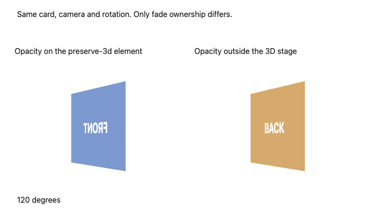

# CSS 3D grouping comparison

Open [index.html](index.html) in a browser. The two cards have identical geometry, camera, angle and face materials. The left applies opacity to the preserve-3d card; the right fades a 2D wrapper around the whole 3D stage. Use `window.draw(0)`, `window.draw(60)`, `window.draw(120)` or `window.draw(180)` in the browser console to inspect an angle. No library, asset fetch or engine installation is needed.

At 120 degrees in the exercised Chrome 156.0.8078.48, the flattened left card shows mirrored FRONT, while the wrapper case shows BACK. [Recorded measurements](verification.json) report four actual angles, pixel counts and computed CSS. Both cards report computed transformStyle preserve-3d; that value alone misses the rendered defect. This is a bounded diagnostic, not a visual template or a production film.

The behavior follows [CSS Transforms grouping rules](https://drafts.csswg.org/css-transforms-2/#grouping-property-values); see also [MDN](https://developer.mozilla.org/en-US/docs/Web/CSS/Reference/Properties/transform-style#description). The CSSWG page is an editor's draft, not a universal conformance guarantee. Other browsers, masks, filter combinations, performance and normal-speed motion were not tested by this comparison. Original example code and screenshot use the repository MIT license.
