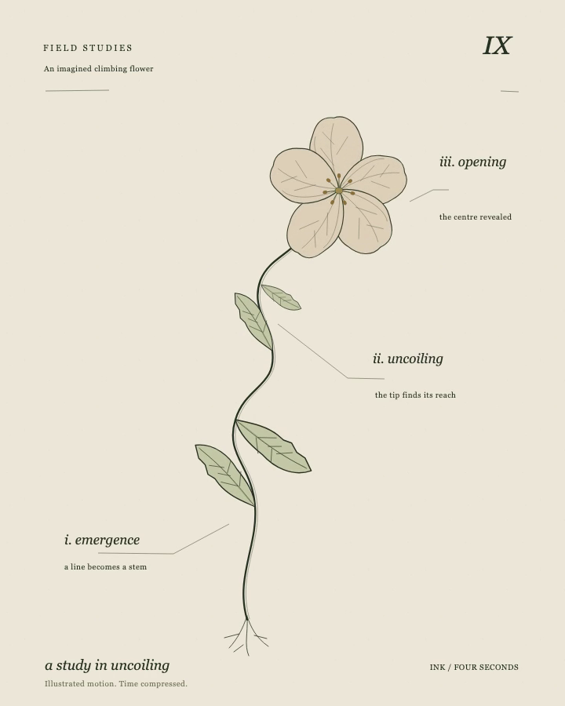

# Field study IX: uncoiling

[Watch the selected movie](ink-study.mp4). A growing line becomes a climbing stem; leaves unfold, the tip uncoils, and a flower opens. This is an original SVG illustration of an imagined plant, with compressed, illustrative timing.

The silent H.264 movie is **720 × 900, 4 seconds, 30 fps, 120 frames**. The preview is decoded from its selected master at 3.5 seconds.

## Editable source and browser preview

Open the movie in a browser for ordinary playback. Open local [index.html](index.html) to inspect the native SVG. It starts at time zero without playback controls; call `window.renderFrame(2.8)` in the browser console to inspect another time. Sampling uses explicit seconds and supports backward replay.

Edit the drawings and annotations in [index.html](index.html), appearance in [style.css](style.css), and growth/leaf/petal timing in [motion.js](motion.js). These three source files are unchanged from the selected render. No framework, network request or downloaded font is required.

Text uses the browser's installed **Georgia**, falling back to Times New Roman or a generic serif. Font substitution can change source-preview text; no font binary is distributed. The movie retains its rendered type.

Sampled source images and encoded frames were inspected, and repeated-time pixels checked. **Human normal-speed perceptual acceptance was not performed.** These checks do not establish pacing quality or botanical accuracy. The movie is intentionally silent.

Original code, drawings and release files use the included [MIT license](LICENSE).
