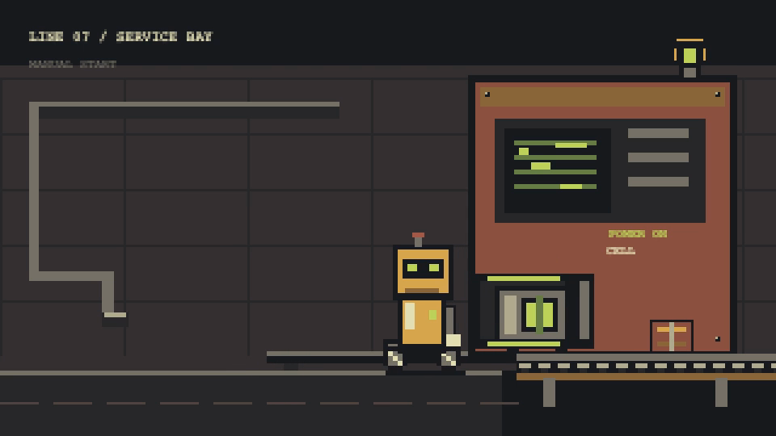

# Line 07: power cell

[Watch the selected movie](power-cell.mp4). A wheeled maintenance rover inserts a power cell; the machine responds, then its conveyor carries a crate. The original Canvas artwork and compressed timing are illustrative.

The silent H.264 movie is **960 × 540, 4 seconds, 30 fps, 120 frames**. A 320 × 180 integer drawing grid is enlarged three times with nearest-neighbor scaling. Poses change at 10 drawings per second. The preview is decoded from the selected master at 3.2 seconds.

## Editable source and browser preview

Open local [index.html?preview=1](index.html?preview=1) for Play, Restart and scrubbing. Playback responds to the browser's reduced-motion preference. Without the query, the source stays paused until `window.renderFrame(seconds)` evaluates it; backward replay is supported.

Edit composition metadata in [index.html](index.html), display treatment in [style.css](style.css), and drawings/action timing in [motion.js](motion.js). These scene files are unchanged from the selected render. All required assets are local. Text uses a native **monospace** font; substitution can alter labels on another system. No font binary is distributed.

Sampled source images and encoded frames were inspected, and repeated-time pixels checked. **Human normal-speed perceptual acceptance was not performed.** These checks do not establish pacing quality. The movie is intentionally silent.

Original code, drawings and release files use the included [MIT license](LICENSE). Bundled GSAP 3.14.2 has separate terms; retain [its notice](THIRD-PARTY.txt) and original library header.
